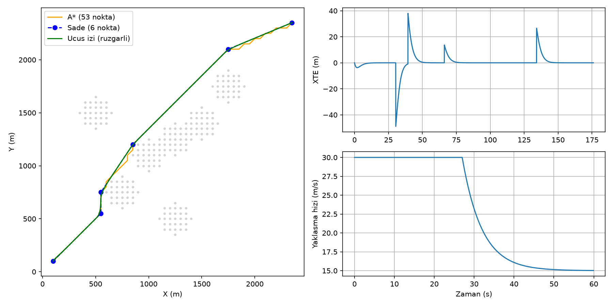
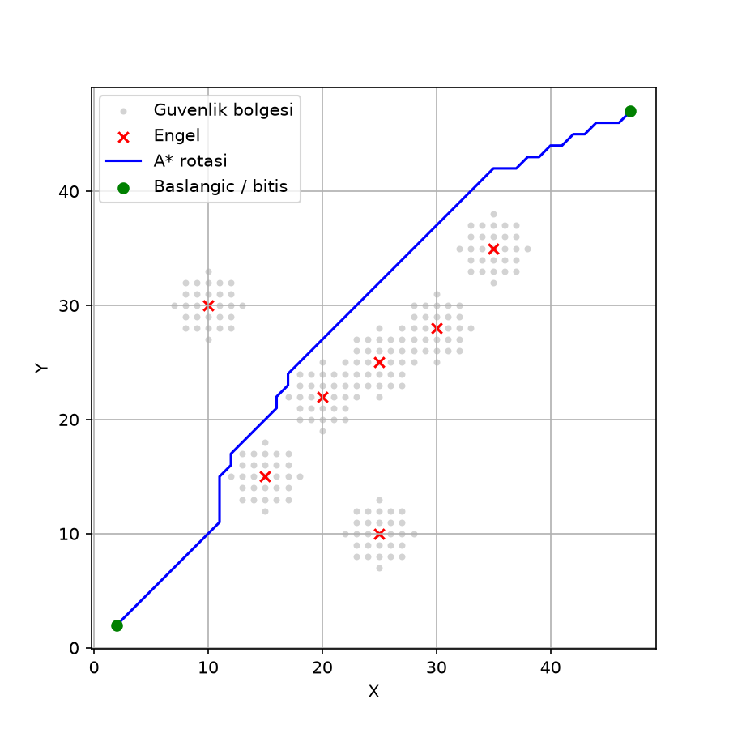
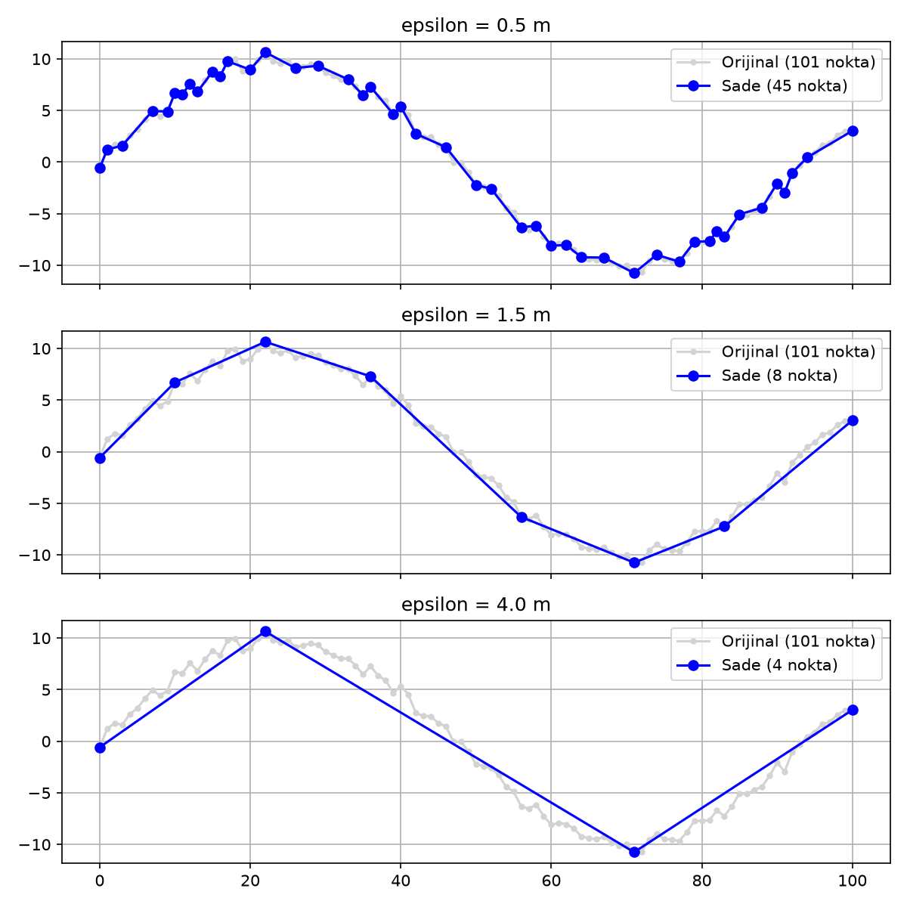
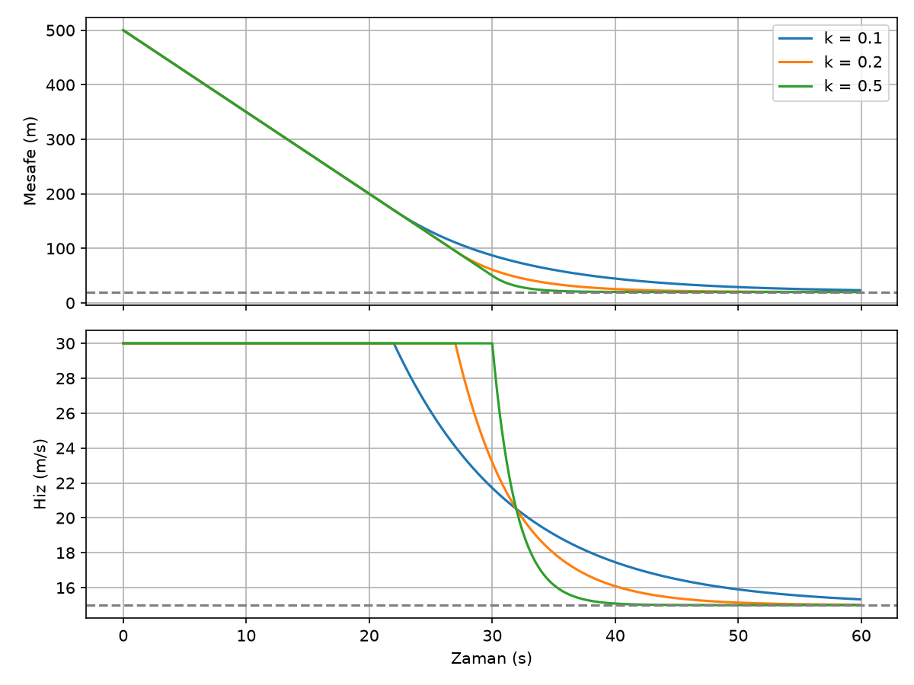
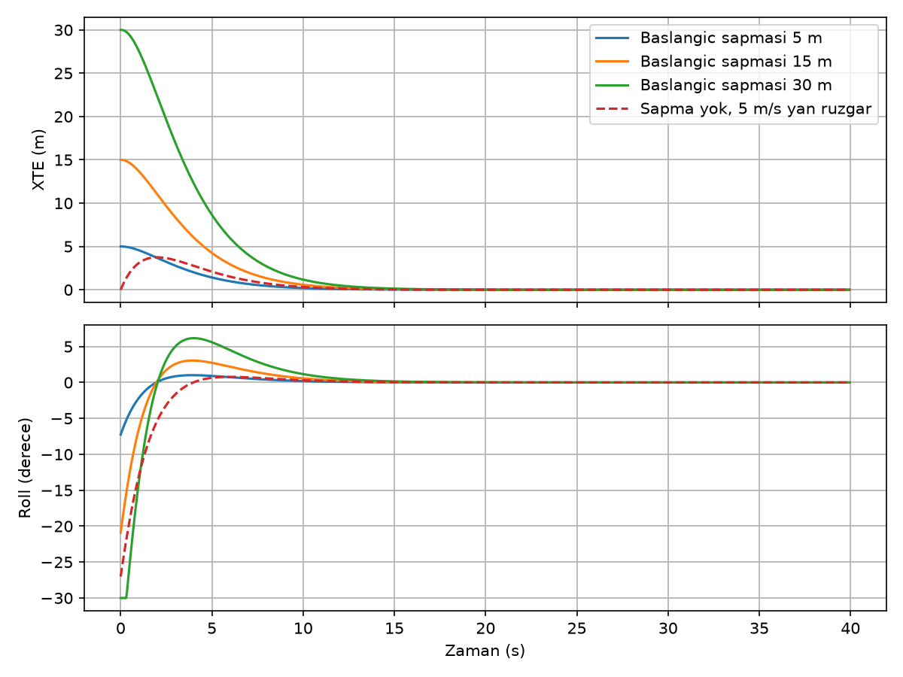

# Akıllı Rota Gerçeklemesi

Çelebi İHA takımı Temel Git ve GitHub Eğitimi, **Proje 8**.

Bu projede bir İHA'nın görev rotası dört adımda ele alındı: engellerden kaçan bir rota bulmak, rotayı sadeleştirmek, aracın rotayı rüzgâr altında sapmadan uçmasını sağlamak ve hareketli bir hedefe güvenli şekilde yaklaşmak. Her adım ayrı bir modülde yazıldı, sonra `main.py` içinde tek bir senaryoda birleştirildi. Parametreleri kaydırıcılarla değiştirilebilen bir Streamlit sitesi de var. Proje iki kişiyle, her görev ayrı bir branch'te ve karşılıklı kod incelemesiyle geliştirildi.



## İçindekiler

- [Ekip ve görev dağılımı](#ekip-ve-görev-dağılımı)
- [Proje yapısı](#proje-yapısı)
- [8.1 A* ile engelden kaçan rota](#81-a-ile-engelden-kaçan-rota)
- [8.4 Douglas-Peucker ile rota sadeleştirme](#84-douglas-peucker-ile-rota-sadeleştirme)
- [8.2 Hareketli hedefe yaklaşma](#82-hareketli-hedefe-yaklaşma)
- [8.3 Rota sapma (XTE) düzeltmesi](#83-rota-sapma-xte-düzeltmesi)
- [Entegrasyon](#entegrasyon)
- [Arayüz (Streamlit sitesi)](#arayüz-streamlit-sitesi)
- [Nasıl çalıştırılır?](#nasıl-çalıştırılır)
- [Nasıl çalıştık?](#nasıl-çalıştık)

## Ekip ve görev dağılımı

İş, projenin iki doğal yarısına göre bölündü. **Azra** rotanın *planlanmasını* (rotayı bulma, sadeleştirme ve parçaları birleştirme), **İclal** aracın *kontrolünü* (hıza ve sapmaya göre komut üretme) üstlendi. Her kişi diğerinin kodunu inceleyip onayladı.

| Kişi | Sorumlu olduğu kısımlar | Dosyalar |
| --- | --- | --- |
| **Azra Öztürker** ([@azraozturker](https://github.com/azraozturker)) | Repo ve proje iskeleti · 8.1 A* · A* testleri · 8.4 Douglas-Peucker · Entegrasyon ve `RotaPlanlayici` sınıfı | `rota/planlama.py`, `rota/sadelestirme.py`, `test_planlama.py`, `main.py` |
| **İclal Öztürk** ([@iclalozturk61](https://github.com/iclalozturk61)) | 8.2 Hareketli hedefe yaklaşma · 8.3 XTE ve roll komutu · Sapma–roll tablosu ve XTE grafikleri · `.gitignore` düzenlemesi · README · Streamlit sitesi | `rota/yaklasma.py`, `rota/xte.py`, `.gitignore`, `README.md`, `app.py` |

Her parçanın kim tarafından yazıldığı ve kimin incelediği:

| Parça | Branch | Pull request | Yazan | İnceleyip birleştiren |
| --- | --- | --- | --- | --- |
| Proje iskeleti | `chore/proje-iskeleti` | #9 | Azra | İclal |
| 8.4 Douglas-Peucker | `feature/douglas-peucker` | #10 | Azra | İclal |
| 8.2 Hedefe yaklaşma | `feature/yaklasma-hizi` | #11 | İclal | Azra |
| 8.3 XTE ve roll komutu | `feature/xte-hesabi` | #12 | İclal | Azra |
| 8.1 A* | `feature/astar` | #13 | Azra | İclal |
| `.vscode` için `.gitignore` | `chore/gitignore` | #14 | İclal | Azra |
| A* testleri | `feature/astar-testler` | #15 | Azra | İclal |
| Sapma–roll tablosu ve grafikler | `feature/xte-roll` | #16 | İclal | Azra |
| Entegrasyon | `feature/entegrasyon` | #17 | Azra | İclal |
| README | `docs/readme` | #21 | İclal | Azra |
| Streamlit sitesi | `feature/streamlit` | #22 | İclal | Azra |

## Proje yapısı

```
akilli-rota/
├── main.py              # Entegrasyon: RotaPlanlayici sınıfı ve uçuş simülasyonu   (Azra)
├── app.py               # Streamlit sitesi                                       (İclal)
├── test_planlama.py     # A* testleri                                            (Azra)
├── requirements.txt     # Gerekli paketler: matplotlib, streamlit
├── gorseller/           # Programların ürettiği grafikler
└── rota/
    ├── planlama.py      # 8.1 A* ile rota planlama                               (Azra)
    ├── sadelestirme.py  # 8.4 Douglas-Peucker ile sadeleştirme                   (Azra)
    ├── yaklasma.py      # 8.2 Hareketli hedefe yaklaşma                          (İclal)
    └── xte.py           # 8.3 Rota sapma düzeltmesi                              (İclal)
```

Her modülün grafik kodu `if __name__ == "__main__":` bloğunun içinde. Modül başka bir dosyadan `import` edildiğinde grafik açılmaz, sadece fonksiyonlar gelir. `main.py` dört modülü bu sayede kullanabiliyor.

## 8.1 A* ile engelden kaçan rota

**Yazan:** Azra · **Dosya:** `rota/planlama.py` · **PR:** #13

50×50 hücrelik bir haritada 7 engel var. Araç bir nokta olmadığı ve rüzgârla sapabileceği için her engelin etrafındaki **3 hücrelik** alan güvenlik bölgesi sayılıyor ve rota bu bölgelere giremiyor.

| Fonksiyon | Görevi |
| --- | --- |
| `engel_haritasi()` | Engellere güvenlik mesafesinden yakın hücreleri kapalı sayar |
| `astar()` | Başlangıçtan hedefe en kısa rotayı bulur, yol yoksa `None` döndürür |
| `rota_uzunlugu()` | Rotadaki ardışık noktalar arası mesafeleri toplar |

Araç 8 yöne gidebiliyor: düz adım 1, çapraz adım yaklaşık 1.41 birim. A* her adımda hem şimdiye kadar yürünen yolu hem de hedefe kalan kuş uçuşu mesafeyi toplayarak en umut verici hücreyi seçiyor. Hedefe varınca "her hücreye nereden gelindi" kayıtları geriye doğru izlenip rota çıkarılıyor.

**Sonuç:** (2,2) → (47,47) rotası **53 nokta, 67.7 birim**. Kuş uçuşu mesafe 63.6 birim; rota engellerin çevresinden dolaştığı için 4.1 birim daha uzun.



### Testler

**Yazan:** Azra · **Dosya:** `test_planlama.py` · **PR:** #15

| Senaryo | Kontrol edilen |
| --- | --- |
| Engelsiz | Rota uzunluğu kuş uçuşu mesafeye eşit mi? (en kısa yol) |
| Engelli | Rota hiçbir yasak hücreye girmiyor mu? |
| Dar geçit | Duvardaki tek boşluk (25,40) bulunuyor mu? |
| Kapalı yol | Yol yoksa `None` dönüyor mu? |

## 8.4 Douglas-Peucker ile rota sadeleştirme

**Yazan:** Azra · **Dosya:** `rota/sadelestirme.py` · **PR:** #10

A* rotası ızgaraya bağlı olduğu için merdiven şeklinde ve çok noktalı. Otopilot her ara noktada bir dönüş komutu ürettiğinden bu kadar nokta gereksiz. Douglas-Peucker, rotanın genel şeklini bozmayan noktaları atıyor:

1. İlk ve son noktayı bir doğruyla birleştir.
2. Aradaki noktalardan bu doğruya en uzak olanı bul (`dik_uzaklik`).
3. En uzak nokta ε'dan yakınsa aradakilerin hepsini at; uzaksa o noktadan ikiye böl ve her yarıya aynısını uygula.

Ne kadar sapmaya izin verileceğini **ε (epsilon)** belirliyor:

| ε | 101 noktalı test rotasında kalan nokta |
| --- | --- |
| 0.5 | 45 |
| 1.5 | 8 |
| 4.0 | 4 |



**Epsilon nasıl seçildi?** Sadeleştirme köşeleri kestiği için rota engellere yaklaşabiliyor. A* rotasında ε = 2.0 rotayı güvenlik bölgesine sokuyor; **ε = 1.0** ise güvenlik payını koruyarak rotayı **53 noktadan 6 noktaya** indiriyor. Entegrasyonda bu değer kullanıldı.

## 8.2 Hareketli hedefe yaklaşma

**Yazan:** İclal · **Dosya:** `rota/yaklasma.py` · **PR:** #11

Araç hedefe uzakken en yüksek hızıyla (30 m/s) gidiyor, yaklaştıkça hızını kalan mesafeyle orantılı düşürüyor ve sonunda hedefle aynı hızda (15 m/s), 20 m geride kalıyor. Hız, mesafenin bir fonksiyonu:

```text
hız = hedef hızı + k × (mesafe − 20 m)     (0 ile 30 m/s arasında sınırlanır)
```

| Fonksiyon | Görevi |
| --- | --- |
| `hiz_komutu()` | Hedefe olan mesafeye göre aracın hızını verir |
| `yaklasma_simulasyonu()` | 500 m'den başlayan yaklaşmayı adım adım simüle eder |

`k` yavaşlamanın ne kadar sert olacağını belirliyor:

| k | 60 s sonunda mesafe | En büyük yavaşlama |
| --- | --- | --- |
| 0.1 | 23.3 m (henüz oturmadı) | 1.5 m/s² |
| **0.2** | **20.1 m** | **3.0 m/s²** |
| 0.5 | 20.0 m | 7.5 m/s² (sert fren) |

Projede yumuşak ama zamanında yaklaşan **k = 0.2** kullanıldı.



## 8.3 Rota sapma (XTE) düzeltmesi

**Yazan:** İclal · **Dosya:** `rota/xte.py` · **PR:** #12, #16

**XTE (cross-track error)**, aracın rota çizgisinden yana doğru ne kadar uzaklaştığı. Uçak direksiyonla değil, yana yatarak (**roll**) döner. `roll_komutu`, hem sapmaya hem de sapmanın ne hızla değiştiğine bakarak aracın kaç derece yatması gerektiğini hesaplıyor:

- Sapma büyüdükçe daha çok yatar.
- Rotaya yaklaşırken yatışı önceden azaltır, böylece rotanın öbür tarafına savrulmaz.
- Yatış en fazla **30°** ile sınırlı.

| Fonksiyon | Görevi |
| --- | --- |
| `roll_komutu()` | Sapmaya ve sapma hızına göre roll açısı |
| `xte_simulasyonu()` | Sapan aracın rotaya dönüşünü adım adım simüle eder |

Sapma hızı sıfırken ilk roll komutu:

| Sapma | Roll komutu |
| --- | --- |
| 5 m | 7.3° |
| 10 m | 14.3° |
| 15 m | 20.9° |
| 30 m ve üstü | 30° (sınır) |

Sağa sapan araç sola yatarak rotaya dönüyor. 30 m'lik sapma yaklaşık 12 saniyede 0.5 m'nin altına iniyor; 5 m/s yan rüzgârda sapma en fazla 3.75 m oluyor ve araç rotaya geri oturuyor. Rüzgârı karşılamak için araç burnunu yaklaşık 14.5° rüzgâra çevirerek uçuyor (yengeç açısı); bu yüzden sapma kalıcı olmuyor.



## Entegrasyon

**Yazan:** Azra · **Dosya:** `main.py` · **PR:** #17

`RotaPlanlayici` sınıfı haritayı ve engelleri bir kez öğreniyor, sonra adımları sırayla çalıştırıyor:

```python
planlayici = RotaPlanlayici(engeller)
rota = planlayici.planla((2, 2), (47, 47))        # 8.1 A*            (Azra)
sade = planlayici.sadelestir(1.0)                 # 8.4 Douglas-Peucker (Azra)
iz, sapmalar = planlayici.uc(ruzgar=(-4.0, 3.0))  # 8.3 roll komutu   (İclal)
```

Uçuşu `rotayi_takip_et` fonksiyonu simüle ediyor: araç sade rotanın her düz parçasını sırayla takip ediyor, rüzgâr onu yana itiyor, İclal'in `roll_komutu` fonksiyonuyla yatarak rotaya dönüyor. Haritanın bir hücresi 50 m sayılıyor ve araç her köşeye 70 m kala bir sonraki parçaya geçerek dönüşleri yumuşak alıyor. Şeklin sağ altında İclal'in yaklaşma simülasyonu gösteriliyor.

| Ölçüt | Değer |
| --- | --- |
| A* rotası | 53 nokta |
| Sade rota (ε = 1.0) | 6 nokta |
| Rüzgâr | x: −4 m/s, y: 3 m/s |
| En büyük sapma | 48.9 m (sadece dönüş anlarında) |
| Engellere en yakın mesafe | 165 m (güvenlik payı 150 m) |
| Uçuş süresi | yaklaşık 176 s |

Sapma grafiğindeki dört sıçrama dönüş noktaları; düz yollarda sapma rüzgâra rağmen sıfırda kalıyor. Araç dönüşlerde bile güvenlik bölgesinin dışında kalıyor. Yani dört parça birlikte doğru çalışıyor.

## Arayüz (Streamlit sitesi)

**Yazan:** İclal · **Dosya:** `app.py` · **PR:** #22

Projenin dört parçası, tarayıcıda açılan bir sitede de çalışıyor. `streamlit run app.py` komutuyla açılır. Kaydırıcı her oynatıldığında simülasyon yeniden çalışıyor ve grafikler anında güncelleniyor. Site, modüllerdeki fonksiyonları doğrudan kullanıyor; `rota/` dosyaları ve `main.py` değişmedi.

| Sekme | Kaydırıcılar | Gösterilenler |
| --- | --- | --- |
| Rota | Güvenlik payı, epsilon, rüzgâr (x ve y) | A* ve sade rota, rota uzunluğu, engele en yakın mesafe; rüzgârlı uçuş izi, en büyük sapma ve uçuş süresi. Sade rota ya da uçuş izi güvenlik bölgesine girerse uyarı verir |
| Kontrol | k, hedef hızı, en yüksek hız · başlangıç sapması, yan rüzgâr, wn | Yaklaşma mesafe ve hız grafikleri, en büyük yavaşlama · Sapma ve roll grafikleri, ilk roll komutu, rotaya oturma süresi |

Site sayesinde README'deki parametre seçimleri canlı görülebiliyor: epsilon 2.0'a çekildiğinde rotanın güvenlik bölgesine girdiği, k büyüdükçe frenin sertleştiği, wn küçüldükçe sapma düzeltmesinin yumuşayıp uzadığı doğrudan izleniyor.

## Nasıl çalıştırılır?

```bash
git clone https://github.com/azraozturker/akilli-rota.git
cd akilli-rota
python -m pip install -r requirements.txt
```

| Komut | Ne yapar |
| --- | --- |
| `streamlit run app.py` | Siteyi tarayıcıda açar (`localhost:8501`) |
| `python main.py` | Bütün senaryoyu çalıştırır, `gorseller/senaryo.png` grafiğini üretir |
| `python test_planlama.py` | A* testlerini çalıştırır |
| `python rota/planlama.py` | A* rotası grafiği |
| `python rota/sadelestirme.py` | Douglas-Peucker grafiği |
| `python rota/yaklasma.py` | Yaklaşma grafiği |
| `python rota/xte.py` | Sapma–roll tablosu ve XTE grafiği |

Komutlar proje klasöründe çalıştırılmalı. Linux'ta `python` yerine `python3` yazın.

## Nasıl çalıştık?

- Her görev GitHub'da bir **issue** olarak açıldı, `rota` etiketi ve **v1.0 teslim** milestone'u verildi, **Projects** panosunda (Todo → In Progress → Done) takip edildi.
- Her görev kendi **branch**'inde yapıldı ve **pull request** ile `main`'e alındı.
- `main` branch'i korumalı: bir PR, diğer ekip üyesi onaylamadan birleştirilemiyor. Yukarıdaki tabloda görüldüğü gibi Azra'nın PR'larını İclal, İclal'in PR'larını Azra inceleyip birleştirdi.
- PR açıklamalarındaki `Closes #N` satırı, PR birleşince ilgili issue'yu otomatik kapattı.
- Commit mesajlarında işin türü belirtildi: `feat:` yeni özellik, `fix:` düzeltme, `test:` test, `refactor:` kodu düzenleme, `chore:` proje işleri, `docs:` doküman.
